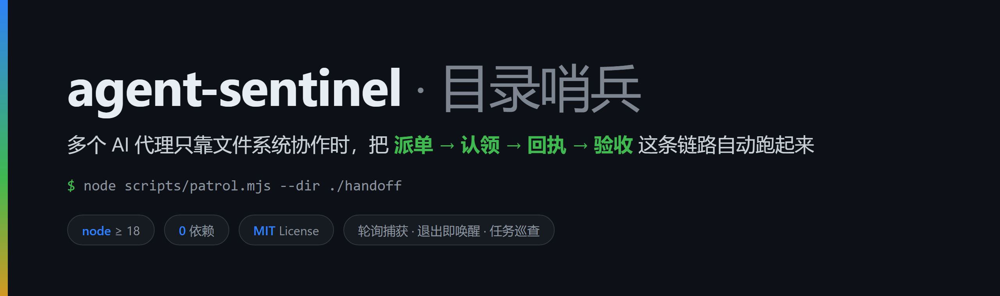
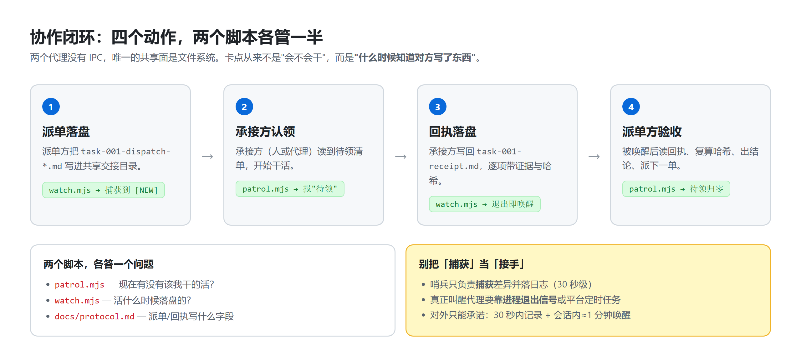
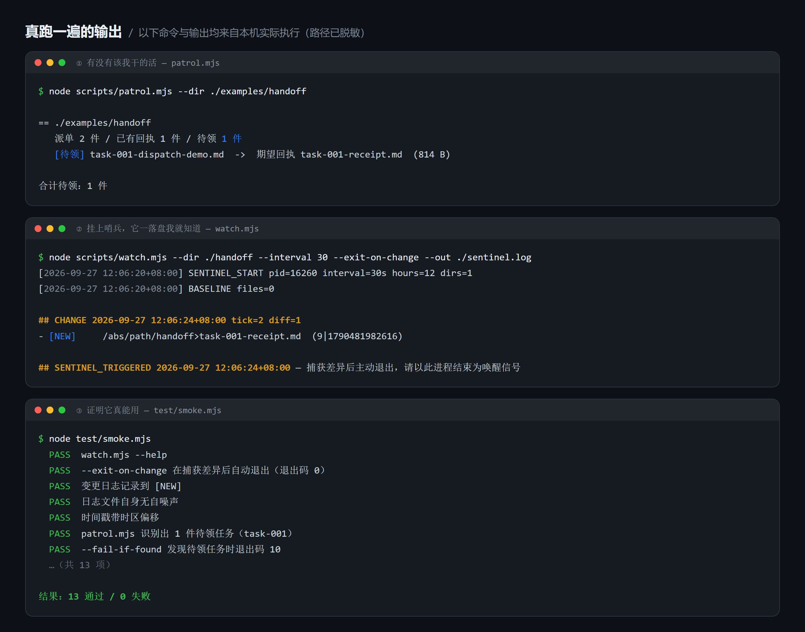
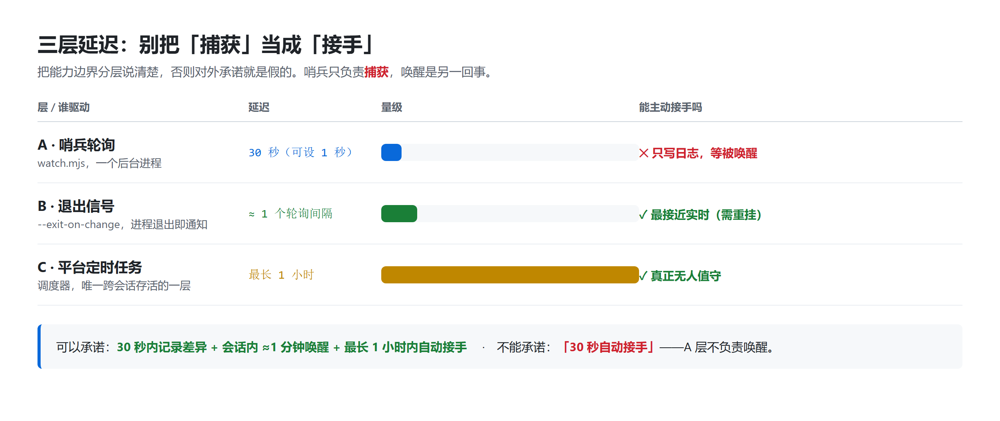

# agent-sentinel



**Wiring up "dispatch → claim → receipt → review" between multiple AI agents that share nothing but a filesystem.**

Zero dependencies (Node ≥ 18). Two scripts and one file-naming convention:

| Script | Answers |
|---|---|
| `scripts/patrol.mjs` | **Is there work waiting for me?** — finds dispatches that have no matching receipt yet. |
| `scripts/watch.mjs` | **When did the other side write?** — polls a handoff directory, logs every change within seconds, optionally exits on first change so the host can wake an agent. |

---

## The problem

Two agents are usually two separate processes with **no IPC channel** — the only shared surface is the filesystem. So the loop looks like:

```
Agent A writes a dispatch into ./handoff/  →  B notices it → B works → B writes a receipt
→  A notices the receipt  →  A reviews
```

The bottleneck is never the work. It is **"when do I learn that the other side wrote something"**:

- a human staring at a folder doesn't scale;
- scheduled jobs are too slow (many platforms bottom out at **1 hour** granularity);
- polling by hand never happens.

`agent-sentinel` handles exactly that layer: **one polling process captures, one process-exit signal wakes, one patrol command decides who is on duty.**

---

## What it looks like

**The loop** — four actions, split across two scripts:



**Real output** (every line below was actually executed on a real machine; absolute paths sanitized):



---

## Quickstart

```bash
git clone <this-repo> agent-sentinel
cd agent-sentinel

# 1) Any work waiting? (a <task>-dispatch-*.md without a matching <task>-receipt.md)
node scripts/patrol.mjs --dir ./examples/handoff

# 2) Mount the sentinel: tell me the moment the other side lands a file
node scripts/watch.mjs --dir ./examples/handoff --interval 30 --hours 8 --out ./sentinel.log
```

Sample log:

```markdown
## SENTINEL_START 2026-09-27 12:06:20+08:00 interval=30s hours=8 pid=16260
- WATCH: /abs/path/to/handoff

## CHANGE 2026-09-27 12:06:24+08:00 tick=2 diff=1
- [NEW]     /abs/path/to/handoff>task-003-dispatch-review.md  (1024|1790481982616)
```

Self-test (offline, no installs):

```bash
node test/smoke.mjs     # 13 assertions
```

---

## The useful trick: use process exit as a wake-up signal

Pass `--exit-on-change` and the sentinel **writes the log and exits as soon as it captures a change**.
Most agent CLIs / IDE extensions notify you when a background task ends — so the exit becomes your wake-up call:

```bash
node scripts/watch.mjs --dir ./handoff --interval 30 --exit-on-change --out ./sentinel.log
```

That yields a ≈ one-interval (30–60 s) wake-up path without waiting on the platform scheduler.

> Honest cost: you must re-mount after each handling, and it does not survive the session.

---

## Three layers of latency — don't confuse *capture* with *takeover*

| Layer | Latency | Driven by | Can it act on its own? |
|---|---|---|---|
| **A. Sentinel polling** (`watch.mjs`) | seconds (30 s default, 1 s possible) | a background process | ❌ writes a log, waits to be woken |
| **B. Exit signal** (`--exit-on-change`) | ≈ one poll interval | process exit → host notification | ✅ but re-mount each time, session-bound |
| **C. Platform scheduler** | platform floor (often **1 hour**) | platform | ✅ the only truly unattended layer |



**Defensible promise:** change recorded within 30 s + in-session wake-up in ≈1 min + unattended takeover within 1 h.
**Indefensible:** "unattended takeover in 30 s". Layer A does not wake anything.

---

## CLI reference

### `watch.mjs`

`--dir <path>` (repeatable, required) · `--interval <sec>` (30) · `--hours <h>` (12) ·
`--out <file>` · `--ignore <substr>` (repeatable) · `--exit-on-change` · `--json`

### `patrol.mjs`

`--dir <dir>` (repeatable, required) · `--dispatch-re <regex>` (capture group 1 = task id) ·
`--receipt <template>` (`{task}-receipt.md`) · `--json` · `--quiet` · `--fail-if-found`

Exit codes: `0` ok · `2` bad usage · `10` pending work found and `--fail-if-found` was set.

---

## Install as an Agent Skill

`SKILL.md` is written **for an AI agent to read**: what it is, how to mount it, the verification
that must be done before claiming "it's mounted", and how to recover a dead instance.
Pair it with [`docs/protocol.md`](docs/protocol.md) — the dispatch/receipt convention that lets two
agents actually understand each other. Without a shared convention, a sentinel alone changes nothing.

---

## Known pitfalls

- Keep the log **out** of the watched directories (the script ignores its own log name; add `--ignore` for others).
- Don't replace polling with `fs.watch` — recursive watching on Windows drops events and pins handles.
- Timestamps are **local time with offset** (`+08:00`), never bare UTC — that would break the "log looks old ⇒ offline" check.
- **Check for a live instance before mounting** — parallel sessions love to double-mount and double-write one log.
- **Always prove it works** after mounting: write a probe file, wait one tick, require `[NEW]` in the log.

---

## Publish

```bash
git init && git add -A && git commit -m "feat: agent-sentinel v1.0.0"
git branch -M main && git remote add origin <your-repo> && git push -u origin main
```

`bin` entries are already configured, so once published to npm: `npx agent-sentinel --help`.

---

## Author

**NIGHMET** · <https://github.com/NIGHMET>

## License

MIT — see [LICENSE](LICENSE).
