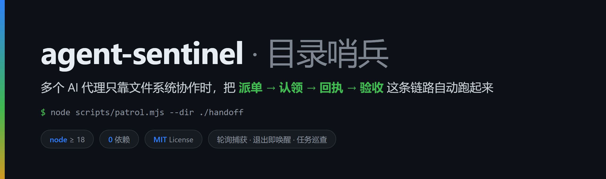
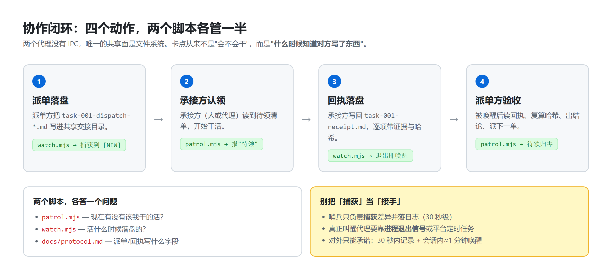
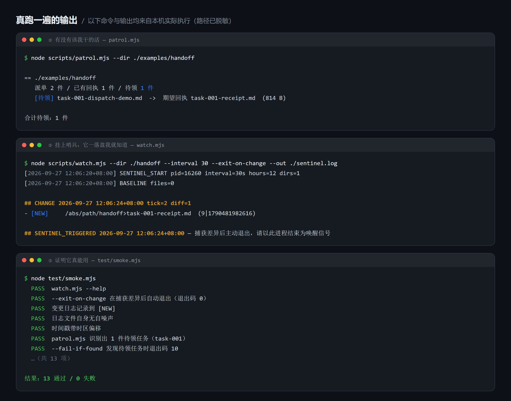
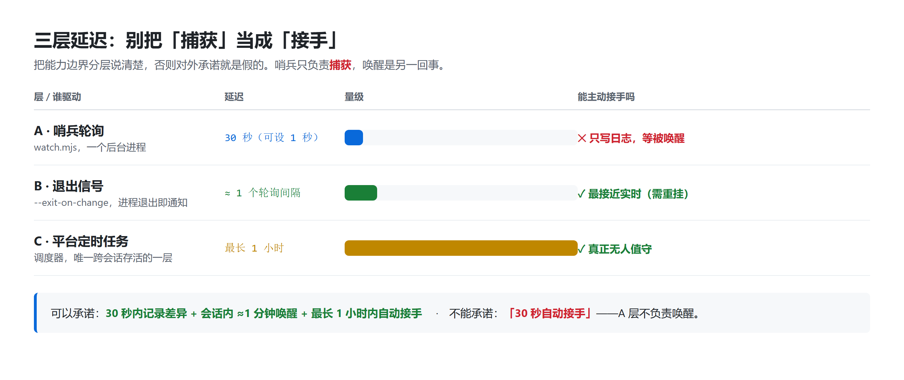

# agent-sentinel



**多个 AI 代理共用一台机器、只靠文件系统交接任务时，用它把「派单 → 认领 → 回执 → 验收」这条链路自动跑起来。**

零依赖（Node ≥ 18，不用装任何包）。两个脚本，一个约定：

| 脚本 | 回答的问题 |
|---|---|
| `scripts/patrol.mjs` | **现在有没有该我干的活？**（在交接目录里找出「有派单、没回执」的任务） |
| `scripts/watch.mjs` | **活什么时候落盘的？**（轮询交接目录，秒级记录差异；可捕获即刻退出，用进程结束叫醒代理） |

---

## 为什么需要它

两个 AI 代理通常是两个独立进程、两个独立会话，**彼此没有 IPC，也没有互相调用的通道**。
唯一的共享面是文件系统。于是协作链路天然长这样：

```
A 代理把派单写进 ./handoff/  →  B 代理发现它 → B 干活 → B 写回执  →  A 发现回执 → 验收
```

卡点从来不是"会不会干"，而是**"什么时候知道对方写了东西"**：

- 人盯着看太累；
- 定时任务太慢（很多平台的调度最小粒度是 1 小时，根本做不到分钟级）；
- 主动轮询又没人写。

`agent-sentinel` 就是把这一层做掉：**一个轮询进程负责捕获，一个退出信号负责唤醒，一个巡查命令负责判断该谁干。**

---

## 它长什么样

**协作闭环**：四个动作，两个脚本各管一半。



**真跑一遍的输出**（下面三组命令与输出都来自本机实际执行，路径已脱敏）：



---

## 30 秒上手

```bash
git clone <本仓库地址> agent-sentinel
cd agent-sentinel

# 1) 看看有没有该领的活（交接目录里 <task>-dispatch-*.md 无对应 <task>-receipt.md）
node scripts/patrol.mjs --dir ./examples/handoff

# 2) 挂上哨兵：它落盘我就知道
node scripts/watch.mjs --dir ./examples/handoff --interval 30 --hours 8 --out ./sentinel.log
```

哨兵日志长这样：

```markdown
## SENTINEL_START 2026-09-27 12:06:20+08:00 interval=30s hours=8 pid=16260
- WATCH: /abs/path/to/handoff

## CHANGE 2026-09-27 12:06:24+08:00 tick=2 diff=1
- [NEW]     /abs/path/to/handoff>task-003-dispatch-review.md  (1024|1790481982616)
```

自测（不联网、不装包）：

```bash
node test/smoke.mjs     # 13 项断言
```

---

## 关键用法：用「进程退出」当唤醒信号

这是本项目最有用的一招。带上 `--exit-on-change`，哨兵**捕获到差异就写日志并退出**。
如果宿主工具支持「后台任务结束时通知我」（多数 agent CLI / IDE 插件都支持），
那么进程一退出就等于把你/代理叫醒：

```bash
node scripts/watch.mjs --dir ./handoff --interval 30 --exit-on-change --out ./sentinel.log
```

于是你得到一个 **≈一个轮询间隔（30~60 秒）** 的唤醒链路，而不用等平台的定时任务。

> 代价要说清楚：每处理完一次要重挂，且它活不过会话/进程结束。

---

## 三层延迟：别把「捕获」当「接手」

这是本项目最想讲清楚的一件事。能力边界必须分层，否则对外承诺就是假的：



| 层 | 延迟 | 谁驱动 | 能主动接手吗 |
|---|---|---|---|
| **A. 哨兵轮询**（`watch.mjs`） | 秒级（默认 30s，可设 1s） | 一个后台进程 | ❌ 只写日志，等被唤醒 |
| **B. 退出信号**（`--exit-on-change`） | ≈ 一个轮询间隔 | 进程退出 → 宿主通知 | ✅ 但每次要重挂，不跨会话 |
| **C. 平台定时任务** | 受平台最小粒度限制（常见下限 **1 小时**） | 平台调度器 | ✅ 真正无人值守的那一层 |

**可以承诺的：** 30 秒内记录差异 + 会话内 ≈1 分钟唤醒 + 最长 1 小时内自动接手。
**不能承诺的：** 「30 秒自动接手」——A 层不负责唤醒，别拿它冒充。

---

## 命令参考

### `watch.mjs`

| 参数 | 说明 |
|---|---|
| `--dir <路径>` | 要监听的目录，**可重复**，至少一个 |
| `--interval <秒>` | 轮询间隔，默认 `30` |
| `--hours <小时>` | 自动退出时限，默认 `12`；跑满写 `SENTINEL_TIMEOUT` 后退场 |
| `--out <文件>` | 变更日志路径；省略则只打到 stdout |
| `--ignore <子串>` | 相对路径命中则跳过，可重复（日志文件自身自动忽略） |
| `--exit-on-change` | 捕获第一批差异后写日志并退出（当唤醒信号用） |
| `--json` | stdout 输出 JSON Lines，便于程序消费（`--out` 仍写 markdown） |

### `patrol.mjs`

| 参数 | 说明 |
|---|---|
| `--dir <目录>` | 交接目录，可重复 |
| `--dispatch-re <正则>` | 派单文件名正则，**第 1 个捕获组必须是 task-id**。默认 `^([A-Za-z0-9_.-]+?)-dispatch[^/]*\.md$` |
| `--receipt <模板>` | 回执名模板，`{task}` 会替换为 task-id。默认 `{task}-receipt.md` |
| `--json` | JSON 输出 |
| `--quiet` | 只出结论 |
| `--fail-if-found` | 有待领任务时退出码 `10`（方便 CI / cron 分支，也能直接喂给 agent 当判断条件） |

退出码：`0` 正常 · `2` 参数错误 · `10` 有待领任务且指定了 `--fail-if-found`。

---

## 作为 Agent Skill 安装

`SKILL.md` 是给 AI 代理读的说明书（技能定义 + 挂载步骤 + 必须做的验证 + 恢复流程）。
把它和你所用平台的技能目录放一起即可；也可以直接把这两个脚本交给代理，让它读 `SKILL.md` 自学。

**协议约定**（派单/回执怎么写、必填哪些字段）见 [`docs/protocol.md`](docs/protocol.md)。
没有共同约定，光有哨兵也接不上手——这一份才是让两个代理"能对话"的东西。

---

## 目录结构

```
agent-sentinel/
├── scripts/
│   ├── watch.mjs       # 目录哨兵：轮询 + 差异日志 + 可选捕获即退出
│   └── patrol.mjs      # 任务巡查：找出「有派单、没回执」
├── test/smoke.mjs      # 零依赖冒烟自测
├── docs/protocol.md    # 交接目录的派单/回执文件约定
├── examples/
│   ├── quickstart.md
│   └── handoff/        # 一个可被 patrol 直接扫的示例交接目录
├── assets/
│   ├── *.png           # README 用的演示图（由 src/ 渲染而来）
│   └── src/*.html      # 图的源文件，可自行改文案后重新渲染
├── SKILL.md            # 给 AI 代理读的技能说明
├── README.md / README.en.md
└── LICENSE (MIT)
```

演示图是 HTML 渲染出来的，**没有手绘、也没有 AI 生成**，里面每一行终端输出都是真跑的结果。
想改文案就编辑 `assets/src/*.html`，然后在目录里跑一条无头 Chrome 命令重新导出（见 `assets/src/README.md`）。

---

## 已知坑（都是实践里踩出来的）

- **日志文件不要放在被监听目录里**：脚本已自动忽略自己的日志文件名，但你要再放别的日志进去，记得 `--ignore`。
- **别用 `fs.watch` 替代轮询**：Windows 上递归监听会漏事件、还会占目录句柄。轮询笨，但跨平台准。
- **时间戳是本地时间带偏移**（`2026-09-27 12:06:20+08:00`）。别改成 `toISOString()`——那是 UTC，会让"日志时间明显早于现在 = 已掉线"这条判据在 UTC+8 下恒误判。
- **挂之前先查有没有还活着的实例**：并行会话很容易重复挂，两个哨兵会双写同一份日志。查法：
  ```bash
  ps -ef | grep watch.mjs          # macOS / Linux
  ```
  ```powershell
  Get-CimInstance Win32_Process -Filter "Name='node.exe'" |
    Where-Object { $_.CommandLine -like '*watch.mjs*' }
  ```
- **挂完必须验活**：往被监听目录写一个探针文件，等一两个 tick，日志里必须出现 `[NEW]`；抓不到就别对外说"哨兵已挂"。
- **有些沙箱里 coreutils 的 PATH 是坏的**：用 node 的绝对路径调用，别在命令里串 `ls` / `dirname`。
- **命令行 stdout 可能被宿主吞掉**：所以重要内容都会落 `--out` 文件，读文件而不是读终端。

---

## 发布到 GitHub

```bash
cd agent-sentinel
git init
git add -A
git commit -m "feat: agent-sentinel v1.0.0 — 零依赖目录哨兵 + 任务巡查"
git branch -M main
git remote add origin <你的仓库地址>
git push -u origin main
```

`package.json` 里已配好 `bin`，发布到 npm 后可直接：

```bash
npx agent-sentinel --help
npx agent-patrol --dir ./handoff
```

---

## 作者

**NIGHMET** · <https://github.com/NIGHMET>

## License

MIT，见 [LICENSE](LICENSE)。
